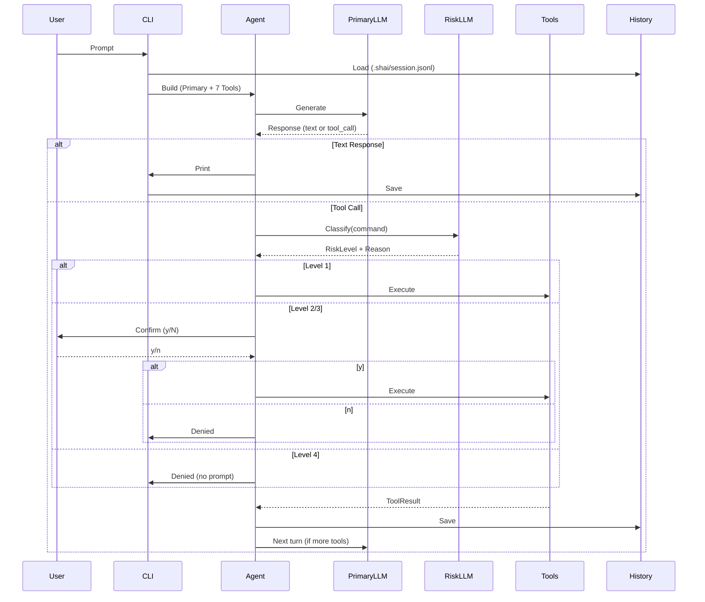

# Architecture

## Core Loop

```
User Prompt
    ↓
Load History (.shai/session.jsonl)
    ↓
AgentBuilder (Primary Model + 7 Tools)
    ↓
Turn Runner (max_turns=1)
    ↓
LLM Response → Text? → Print & Save History
    ↓
Tool Call → Risk Classifier (Risk Model)
    ↓
Level 1 (Allowed) → Execute immediately
Level 2/3 (ReadSensitive/WriteRecoverable) → Prompt user y/N
Level 4 (Catastrophic) → Deny
    ↓
ToolResult → History → Next Turn
```

## Key Design Decisions (ADRs)

| ADR | Decision |
|-----|----------|
| [ADR-001](adr/001-llm-only-risk.md) | LLM-only risk classification (no hardcoded deny/allow) |
| [ADR-002](adr/002-manual-agent-loop.md) | Manual turn-by-turn loop with `max_turns(1)` |
| [ADR-003](adr/003-shell-execution.md) | Shell execution via `sh -c` |
| [ADR-004](adr/004-per-directory-history.md) | Per-directory history: `.shai/session.jsonl` |
| [ADR-005](adr/005-non-streaming.md) | Non-streaming for v1 |
| [ADR-006](adr/006-dual-llm-risk.md) | Dual LLM: primary + separate risk model |
| [ADR-007](adr/007-rig-umbrella.md) | rig 0.46 umbrella crate with `agent` feature |
| [ADR-008](adr/008-provider-config.md) | Config: TOML + env vars (Env > TOML > Defaults) |
| [ADR-009](adr/009-tool-set.md) | 7 v1 tools (read/inspect/web) |
| [ADR-010](adr/010-rag-v2.md) | RAG v2 deferred |
| [ADR-011](adr/011-ssh-v2.md) | SSH v2 deferred |

## Components

### Config (`src/config.rs`)

```rust
Config::load() -> Result<Config>
// Priority: Env > ~/.config/shai/config.toml > .shai/config.toml > Defaults
```

### Provider Factory (`src/provider.rs`)

```rust
build_model(&ProviderConfig) -> Result<DynModel<Completion>>
// Supports: openai, anthropic, ollama
```

### Agent Loop (`src/agent.rs`)

```rust
run_agent(prompt: &str, config: &Config) -> Result<String>
// Builds AgentBuilder with all 7 tools
// Manual loop: max_turns(1), handles tool calls, risk, confirmation
```

### Risk Classifier (`src/risk/classifier.rs`)

```rust
RiskClassifier::new(model: DynModel<Completion>)
evaluate(command: &str, cwd: &str, recent: &[String]) -> Result<RiskResult>
// RiskResult { level: RiskLevel, reason: String }
// RiskLevel: Allowed(1), ReadSensitive(2), WriteRecoverable(3), Catastrophic(4)
```

### Tool Registry (`src/tool/mod.rs`)

```rust
ToolRegistry::dispatch(tool_call: &ToolCall, risk_classifier: &RiskClassifier, config: &Config) -> Result<ToolResult>
// Handles 7 tools, integrates risk for shell
```

## Data Flow

1. **Input**: User prompt (CLI arg or REPL)
2. **History Load**: Read `.shai/session.jsonl` (max 50 turns)
3. **Agent Build**: Create `AgentBuilder` with primary model + 7 tools
4. **Turn Loop**: Single turn (`max_turns=1`)
   - LLM generates response
   - If text → print, save to history
   - If tool call → risk classification → confirm/execute/deny
   - Tool result → history → next turn (if more tools)
5. **History Save**: Append to `.shai/session.jsonl`

## Project Structure

```
shai/
├── Cargo.toml
├── src/
│   ├── main.rs           # CLI entry: one-shot vs REPL
│   ├── config.rs         # TOML + env loading, priority merge
│   ├── provider.rs       # Model factory (OpenAI/Anthropic/Ollama)
│   ├── agent.rs          # Turn-by-turn runner
│   ├── history.rs        # JSONL load/save
│   ├── repl.rs           # rustyline REPL
│   ├── risk/
│   │   ├── classifier.rs # Risk evaluation
│   │   └── prompt.rs     # Few-shot risk prompt
│   └── tool/
│       ├── mod.rs        # Tool registry & dispatch
│       ├── shell.rs      # Shell execution with risk
│       ├── read.rs       # File reading
│       ├── glob.rs       # Pattern matching
│       ├── grep.rs       # Content search
│       ├── list_dir.rs   # Directory listing
│       ├── web_search.rs # DuckDuckGo scraping
│       └── web_fetch.rs  # URL content extraction
├── tests/
│   └── integration.rs
└── docs/
    ├── architecture/     # ADRs, component, data-flow, config, etc.
    └── superpowers/      # Specs & plans
```

## Sequence Diagram



## Technology Stack

| Component | Technology |
|-----------|------------|
| Language | Rust 2021 |
| LLM Framework | `rig` 0.46 (features: `agent`, `reqwest`, `derive`) |
| CLI | `clap` 4 with derive + env |
| REPL | `rustyline` 12 |
| Async Runtime | `tokio` 1 (full features) |
| Providers | OpenAI, Anthropic, Ollama |
| Serialization | `serde` + `toml` |

## Security Model

1. **No Hardcoded Rules** — All risk decisions via LLM (ADR-001)
2. **Path Validation** — File tools restricted to CWD
3. **Shell via `sh -c`** — Supports pipes, redirects, builtins
4. **User Confirmation** — Required for Level 2/3 operations
5. **Catastrophic Deny** — Level 4 never executes
6. **History Local** — JSONL stays in project directory

## Extending shai

### Adding a New Tool

1. Create `src/tool/your_tool.rs` implementing `rig::tool::Tool`
2. Add `description()`, `parameters()` (via `schemars::schema_for!`)
3. Register in `src/tool/mod.rs` dispatch
4. Add risk handling in `handle_*`
5. Write unit tests in `#[cfg(test)]` module

### Risk Levels for New Tools

| Level | When |
|-------|------|
| 1 (Allowed) | Read-only, no side effects, no sensitive data |
| 2 (ReadSensitive) | Reads secrets, PII, auth tokens |
| 3 (WriteRecoverable) | Writes/deletes but recoverable |
| 4 (Catastrophic) | Irrecoverable destruction |

### Modifying Risk Prompt

Edit `src/risk/prompt.rs`:
- `build_risk_prompt()` — template with few-shot examples
- JSON output: `{"level": 1-4, "reason": "..."}`

## Further Reading

- [All ADRs](adr/) — Architecture Decision Records
- [Specifications](../superpowers/specs/) — Design specs
- [Implementation Plans](../superpowers/plans/) — Task breakdowns
