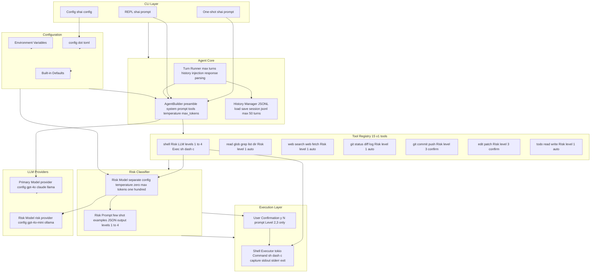

# Component Architecture

High-level system components and their relationships.

---

## Component Responsibilities

| Component | Responsibility |
|-----------|----------------|
| **CLI Layer** | Parse args, dispatch to one-shot/REPL/config |
| **AgentBuilder** | Configure primary model, preamble, tools |
| **Turn Runner** | Execute one turn, parse response |
| **History Manager** | Load/save JSONL, trim to 50 turns |
| **Tool Registry** | 15 tools with fixed risk levels + shell LLM-classified |
| **Risk Classifier** | Separate LLM call, temperature zero, JSON output |
| **Shell Executor** | sh dash c via tokio, capture stdout stderr exit |
| **User Confirmation** | Blocking y N prompt for Level 2,3 |
| **Providers** | OpenAI, Anthropic, Ollama factories |
| **Configuration** | Env greater than TOML greater than Defaults priority merge |

---

## Key Design Decisions

- **Dual LLM** (ADR-006): Primary for commands, separate Risk model
- **Manual Turn Loop** (ADR-002): max turns 1 for full control
- **LLM-only Risk** (ADR-001): No deny allow patterns, few-shot prompt
- **Shell via sh dash c** (ADR-003): Supports pipes redirects builtins