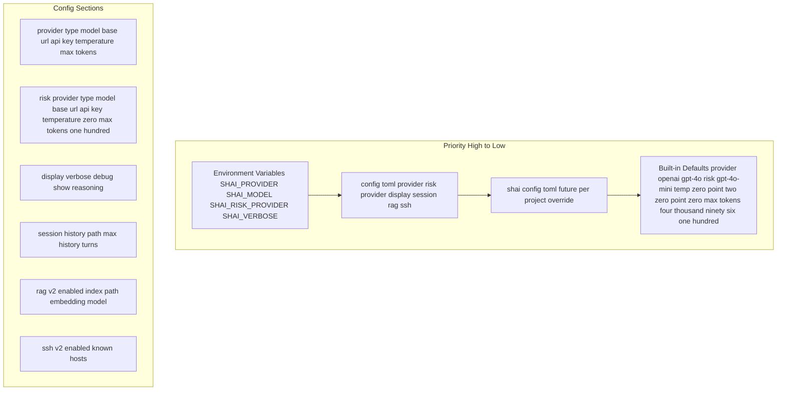

# Configuration Hierarchy

Priority-based configuration loading with all sections.



---

## Priority Order

```
Environment Variables (highest)
    ↓
~/.config/shai/config.toml
    ↓
.shai/config.toml (future, per-project)
    ↓
Built-in Defaults (lowest)
```

---

## Full Config Schema

### `[provider]` — Primary Model
```toml
[provider]
type = "openai"        # "openai" | "anthropic" | "ollama"
model = "gpt-4o"       # provider-specific model id
base_url = ""          # optional override (e.g. "https://api.openai.com/v1")
api_key = ""           # optional, env var takes precedence
temperature = 0.2
max_tokens = 4096
```

### `[risk_provider]` — Risk Classification Model (Optional)
```toml
[risk_provider]
type = "openai"        # optional: defaults to [provider] if omitted
model = "gpt-4o-mini"  # smaller/faster model for risk
base_url = ""          # optional override
api_key = ""           # optional, env var takes precedence
temperature = 0.0      # deterministic for risk classification
max_tokens = 100       # only needs JSON output
```

**Fallback:** If omitted, uses `[provider]` config.

### `[display]` — Output Flags
```toml
[display]
verbose = false      # Show full tool output (stdout, stderr, exit code)
debug = false        # Show tool calls, risk levels, raw LLM responses, timing
show_reasoning = false  # Show model reasoning (if supported: o1, deepseek-r1)
```

### `[session]` — History
```toml
[session]
history_path = ".shai/session.jsonl"
max_history_turns = 50
```

### `[rag]` (v2) — Local Vector Index
```toml
[rag]
enabled = false
index_path = ".shai/rag"
embedding_model = "nomic-embed-text"  # Ollama or local
chunk_size = 512
chunk_overlap = 50
```

### `[ssh]` (v2) — Remote Execution
```toml
[ssh]
enabled = false
known_hosts = []  # optional override, uses ~/.ssh/config by default
```

---

## Environment Variables

| Variable | Maps To | Example |
|----------|---------|---------|
| `SHAI_PROVIDER` | `provider.type` | `anthropic` |
| `SHAI_MODEL` | `provider.model` | `claude-3-5-sonnet` |
| `SHAI_BASE_URL` | `provider.base_url` | `https://api.anthropic.com` |
| `SHAI_API_KEY` | `provider.api_key` | `sk-...` |
| `SHAI_TEMPERATURE` | `provider.temperature` | `0.3` |
| `SHAI_MAX_TOKENS` | `provider.max_tokens` | `8192` |
| `SHAI_RISK_PROVIDER` | `risk_provider.type` | `ollama` |
| `SHAI_RISK_MODEL` | `risk_provider.model` | `llama3.1` |
| `SHAI_RISK_BASE_URL` | `risk_provider.base_url` | `http://localhost:11434` |
| `SHAI_RISK_API_KEY` | `risk_provider.api_key` | (unused for Ollama) |
| `SHAI_RISK_TEMPERATURE` | `risk_provider.temperature` | `0.0` |
| `SHAI_RISK_MAX_TOKENS` | `risk_provider.max_tokens` | `100` |
| `SHAI_VERBOSE` | `display.verbose` | `true` |
| `SHAI_DEBUG` | `display.debug` | `true` |
| `SHAI_SHOW_REASONING` | `display.show_reasoning` | `true` |
| `SHAI_RAG_ENABLED` | `rag.enabled` | `true` |
| `SHAI_RAG_INDEX_PATH` | `rag.index_path` | `.shai/rag` |
| `SHAI_RAG_EMBEDDING_MODEL` | `rag.embedding_model` | `nomic-embed-text` |
| `SHAI_SSH_ENABLED` | `ssh.enabled` | `true` |
| `OPENAI_API_KEY` | Fallback for OpenAI | `sk-...` |
| `ANTHROPIC_API_KEY` | Fallback for Anthropic | `sk-...` |
| `OLLAMA_API_BASE_URL` | Fallback for Ollama | `http://localhost:11434` |

---

## Config Loading (Rust)

```rust
// Priority merge: Env > TOML > Defaults
let config = Config::load()?;
// 1. Start with defaults
// 2. Merge ~/.config/shai/config.toml
// 3. Merge .shai/config.toml (if exists)
// 4. Override with environment variables
```

ADR: [ADR-008](../ADR.md#adr-008-provider-config-via-toml--environment-variables)