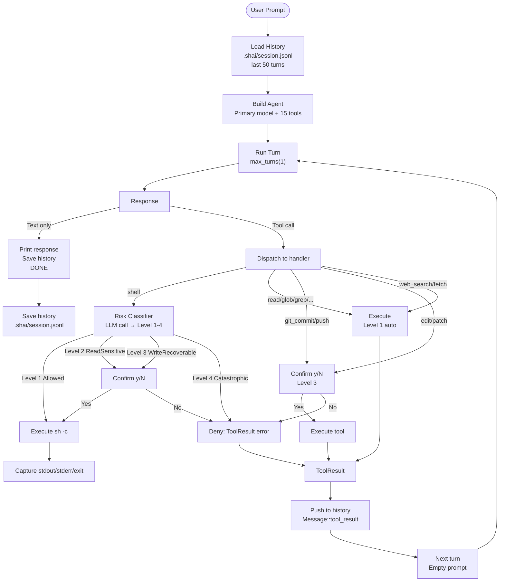

# Data Flow: One Turn

Complete flow for a single agent turn from user prompt to response.



---

## Turn Phases

| Phase | Action | Component |
|-------|--------|-----------|
| **1. Load** | Read last 50 messages from `.shai/session.jsonl` | History Manager |
| **2. Build** | Create AgentBuilder with primary model + 15 tools | AgentBuilder |
| **3. Run** | Execute one turn (`max_turns(1)`) | Turn Runner |
| **4. Dispatch** | Route tool call to handler | Tool Registry |
| **5. Risk** | LLM classifies `shell` commands (Level 1-4) | Risk Classifier |
| **6. Confirm** | Prompt user for Level 2/3 | User Confirmation |
| **7. Execute** | Run command/tool, capture result | Shell Executor / Tool Handler |
| **8. History** | Append `ToolResult` as `Message::tool_result` | History Manager |
| **9. Next** | Loop with empty prompt (continuation) | Turn Runner |
| **10. Final** | Print response.text(), save history | CLI |

---

## Tool Risk Levels

| Tool | Risk Level | Confirmation |
|------|------------|--------------|
| `shell` | 1–4 (LLM) | Level 2/3: y/N, Level 4: deny |
| `read`, `glob`, `grep`, `list_dir` | 1 (Allowed) | None |
| `web_search`, `web_fetch` | 1 (Allowed) | None |
| `git_status`, `git_diff`, `git_log` | 1 (Allowed) | None |
| `git_commit`, `git_push` | 3 (WriteRecoverable) | Yes |
| `edit`, `patch` | 3 (WriteRecoverable) | Yes |
| `todo_read`, `todo_write` | 1 (Allowed) | None |

---

## History Format (JSONL)

```json
{"role":"user","content":"list files"}
{"role":"assistant","content":"","tool_calls":[{"id":"call_1","name":"shell","arguments":"{\"command\":\"ls -la\"}"}]}
{"role":"tool","tool_call_id":"call_1","content":"{\"stdout\":\"...\",\"stderr\":\"\",\"exit_code\":0}"}
{"role":"assistant","content":"Here are your files..."}
```

Each turn appends 2-4 lines: user prompt → assistant (with tool_calls) → tool result → assistant (final)