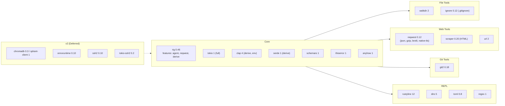

# Dependencies

Dependency graph by category.



---

## Cargo.toml (v1)

```toml
[package]
name = "shai"
version = "0.1.0"
edition = "2021"

[dependencies]
# Core
rig = { version = "0.46", features = ["agent", "reqwest", "derive"] }
tokio = { version = "1", features = ["full"] }
clap = { version = "4", features = ["derive", "env"] }
serde = { version = "1", features = ["derive"] }
serde_json = "1"
schemars = "1"
thiserror = "1"
anyhow = "1"
tracing = "0.1"
tracing-subscriber = { version = "0.3", features = ["env-filter"] }
dirs = "5"
toml = "0.8"
regex = "1"
rustyline = "12"

# File Tools
walkdir = "2"
ignore = "0.12"

# Web Tools
reqwest = { version = "0.12", features = ["json", "gzip", "brotli", "native-tls"] }
scraper = "0.20"
url = "2"

# Git Tools
git2 = "0.18"
```

---

## By Category

### Core (Required)
| Crate | Version | Purpose |
|-------|---------|---------|
| `rig` | 0.46 | LLM framework (AgentBuilder, tools, providers) |
| `tokio` | 1 | Async runtime, process execution |
| `clap` | 4 | CLI parsing with derive + env |
| `serde` | 1 | Serialization |
| `serde_json` | 1 | JSON handling |
| `schemars` | 1 | JSON Schema for tool parameters |
| `thiserror` | 1 | Error derive |
| `anyhow` | 1 | Error handling |
| `tracing` | 0.1 | Logging |
| `tracing-subscriber` | 0.3 | Log subscriber |
| `dirs` | 5 | Config dir paths |
| `toml` | 0.8 | Config parsing |
| `regex` | 1 | Pattern matching |
| `rustyline` | 12 | REPL readline |

### File Tools
| Crate | Version | Purpose |
|-------|---------|---------|
| `walkdir` | 2 | Directory traversal for `glob`, `list_dir` |
| `ignore` | 0.12 | `.gitignore` support for file tools |

### Web Tools
| Crate | Version | Purpose |
|-------|---------|---------|
| `reqwest` | 0.12 | HTTP client for `web_search`, `web_fetch` |
| `scraper` | 0.20 | HTML parsing for `web_fetch` |
| `url` | 2 | URL parsing/validation |

### Git Tools
| Crate | Version | Purpose |
|-------|---------|---------|
| `git2` | 0.18 | Git operations (status, diff, log, commit, push) |

---

## v2 Dependencies (Deferred)

```toml
# RAG (v2)
chromadb = "0.3"        # or qdrant-client = "1"
onnxruntime = "0.10"    # local embeddings, or use Ollama via reqwest

# SSH (v2)
ssh2 = "0.10"
tokio-ssh2 = "0.2"      # if available, else sync in thread pool
```

| Feature | Crates | Notes |
|---------|--------|-------|
| **RAG** | `chromadb`/`qdrant-client`, `onnxruntime` | Local vector index, embeddings via Ollama or ONNX |
| **SSH** | `ssh2`, `tokio-ssh2` | Key-based auth, `~/.ssh/config` |

---

## Feature Flags (rig)

```toml
rig = { version = "0.46", features = ["agent", "reqwest", "derive"] }
```

| Feature | Enables |
|---------|---------|
| `agent` | `AgentBuilder`, `AgentRunner`, `AgentHook`, `Tool` trait |
| `reqwest` | HTTP clients for all providers (`OpenAIConfig::client()`, etc.) |
| `derive` | `#[rig_tool]` macro for automatic `Tool` impl |

---

## ADR References

- [ADR-007](../ADR.md#adr-007-rig-046-umbrella-crate-with-agent-feature): rig 0.46 umbrella crate
- [ADR-009](../ADR.md#adr-009-tool-set-v1--readwriteinspectwebgit): v1 tool set dependencies
- [ADR-010](../ADR.md#adr-010-rag-integration-v2--local-per-directory-index): RAG v2 deps
- [ADR-011](../ADR.md#adr-011-ssh-integration-v2--key-based-only): SSH v2 deps