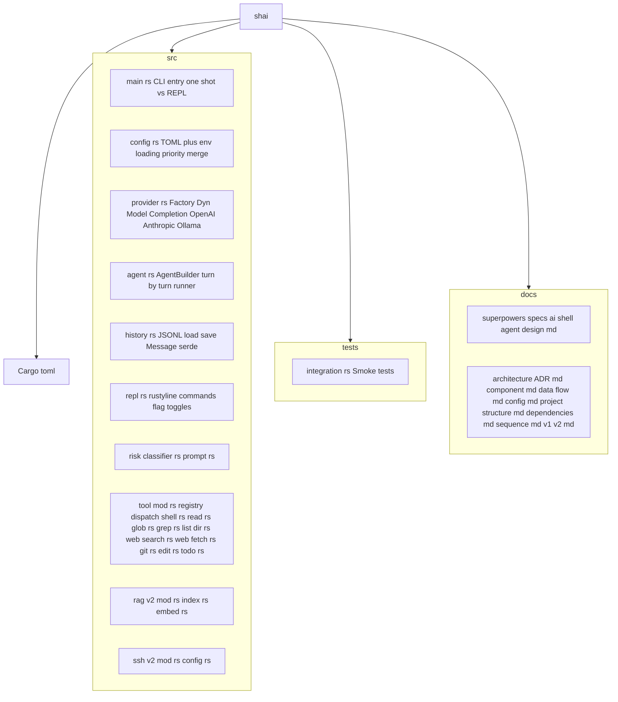

# Project Structure

Source tree with all modules.



---

## Source Files

| File | Purpose |
|------|---------|
| `main.rs` | CLI entry: parse args, dispatch to `run_once()` or `run_repl()` |
| `config.rs` | `Config` struct, `load()` with priority merge, all sections |
| `provider.rs` | `build_model(provider_config)` → `DynModel<Completion>` for OpenAI/Anthropic/Ollama |
| `agent.rs` | `AgentBuilder` setup, turn-by-turn runner loop, tool dispatch |
| `history.rs` | `History` struct: `load()`, `push()`, `save()`, JSONL serialization |
| `repl.rs` | `rustyline` REPL: readline, `/commands`, flag toggles (`/verbose`, etc.) |
| `risk/classifier.rs` | `RiskClassifier::new(model)`, `evaluate(command)` → `RiskLevel` |
| `risk/prompt.rs` | Risk prompt template, few-shot examples, JSON parsing |
| `tool/mod.rs` | Tool registry, dispatch match, risk integration |
| `tool/shell.rs` | `#[rig_tool] shell_tool`, `ShellArgs`, `ShellOutput`, `ShellError` |
| `tool/read.rs` | `#[rig_tool] read_tool`, file reading with path validation |
| `tool/glob.rs` | `#[rig_tool] glob_tool`, pattern matching with `walkdir` + `ignore` |
| `tool/grep.rs` | `#[rig_tool] grep_tool`, content search with regex |
| `tool/list_dir.rs` | `#[rig_tool] list_dir_tool`, directory listing |
| `tool/web_search.rs` | `#[rig_tool] web_search_tool`, search API integration |
| `tool/web_fetch.rs` | `#[rig_tool] web_fetch_tool`, HTTP GET + HTML parsing |
| `tool/git.rs` | `#[rig_tool] git_status/diff/log/commit/push`, `git2` wrapper |
| `tool/edit.rs` | `#[rig_tool] edit_tool`, `patch_tool`, diff preview |
| `tool/todo.rs` | `#[rig_tool] todo_read/write_tool`, in-memory task list |
| `rag/mod.rs` (v2) | RAG pipeline: ingest, query, index management |
| `rag/index.rs` (v2) | Vector index: ChromaDB/Qdrant embedded |
| `rag/embed.rs` (v2) | Embedding model: Ollama or ONNX Runtime |
| `ssh/mod.rs` (v2) | SSH client wrapper, command execution |
| `ssh/config.rs` (v2) | Host config from `~/.ssh/config` |

---

## Directory Layout

```
shai/
├── Cargo.toml
├── src/
│   ├── main.rs
│   ├── config.rs
│   ├── provider.rs
│   ├── agent.rs
│   ├── history.rs
│   ├── repl.rs
│   ├── risk/
│   │   ├── classifier.rs
│   │   └── prompt.rs
│   ├── tool/
│   │   ├── mod.rs
│   │   ├── shell.rs
│   │   ├── read.rs
│   │   ├── glob.rs
│   │   ├── grep.rs
│   │   ├── list_dir.rs
│   │   ├── web_search.rs
│   │   ├── web_fetch.rs
│   │   ├── git.rs
│   │   ├── edit.rs
│   │   └── todo.rs
│   ├── rag/              # v2
│   │   ├── mod.rs
│   │   ├── index.rs
│   │   └── embed.rs
│   └── ssh/              # v2
│       ├── mod.rs
│       └── config.rs
├── tests/
│   └── integration.rs
└── docs/
    ├── architecture/
    │   ├── README.md
    │   ├── ADR.md
    │   ├── component.md
    │   ├── data-flow.md
    │   ├── config.md
    │   ├── project-structure.md
    │   ├── dependencies.md
    │   ├── sequence.md
    │   └── v1-v2.md
    └── superpowers/specs/
        └── 2026-11-08-ai-shell-agent-design.md
```

---

## Module Dependencies

```
main.rs
├── config.rs
├── provider.rs
├── agent.rs
│   ├── risk/classifier.rs
│   ├── tool/mod.rs
│   │   ├── tool/shell.rs
│   │   ├── tool/read.rs
│   │   ├── tool/glob.rs
│   │   ├── tool/grep.rs
│   │   ├── tool/list_dir.rs
│   │   ├── tool/web_search.rs
│   │   ├── tool/web_fetch.rs
│   │   ├── tool/git.rs
│   │   ├── tool/edit.rs
│   │   └── tool/todo.rs
│   └── history.rs
└── repl.rs
    └── agent.rs (reuse)
```

ADR: [ADR-007](../ADR.md#adr-007-rig-046-umbrella-crate-with-agent-feature)