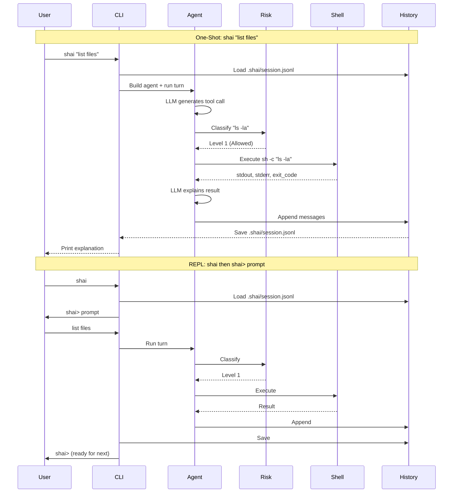

# Sequence: One-Shot vs REPL

Interaction flows for both CLI modes.



---

## One-Shot Mode

```
$ shai "list all .rs files modified this week"
```

| Step | Component | Action |
|------|-----------|--------|
| 1 | CLI | Parse args, extract prompt |
| 2 | Config | Load config (Env > TOML > Defaults) |
| 3 | History | Load `.shai/session.jsonl` (last 50 turns) |
| 4 | Provider | Build primary + risk models |
| 5 | Agent | Build AgentBuilder with tools + preamble |
| 6 | Turn Runner | `agent.prompt(prompt).history(hist).max_turns(1).await` |
| 7 | LLM | Generates tool call: `shell("find . -name '*.rs' -mtime -7")` |
| 8 | Risk | Classifies command → Level 1 (Allowed) |
| 9 | Shell | Execute `sh -c "find ..."`, capture stdout/stderr/exit |
| 10 | ToolResult | Wrap result as `Message::tool_result` |
| 11 | History | Push to history vector |
| 12 | Turn Runner | Next turn (empty prompt) |
| 13 | LLM | Receives result, generates final explanation |
| 14 | History | Append final messages, save to JSONL |
| 15 | CLI | Print response.text() to stdout |

---

## REPL Mode

```
$ shai
shai> list all .rs files modified this week
shai> now show me the diff for the largest one
shai> /exit
```

| Step | Component | Action |
|------|-----------|--------|
| 1 | CLI | Start REPL, load config + history |
| 2 | REPL | Print prompt `shai> `, await readline |
| 3 | User | Types prompt, presses Enter |
| 4 | REPL | If `/command`: handle internally (`/exit`, `/verbose`, etc.) |
| 5 | REPL | If prompt: call `run_turn(prompt)` |
| 6 | Agent | Same as one-shot: run turn, risk, exec, history |
| 7 | REPL | Print response, loop to step 2 |
| 8 | `/exit` | Save history, cleanup, exit |

---

## REPL Commands

| Command | Action | Implementation |
|---------|--------|----------------|
| `/exit`, `/quit` | Save history, exit | `history.save()?; std::process::exit(0)` |
| `/history [N]` | Show last N turns | Parse history, print formatted |
| `/clear` | Clear history file | `std::fs::remove_file(path)?` |
| `/config` | Show current config | `println!("{:#?}", config)` |
| `/risk <cmd>` | Dry-run risk classification | `risk_classifier.evaluate(cmd).await` |
| `/verbose` | Toggle verbose flag | `config.display.verbose = !config.display.verbose` |
| `/debug` | Toggle debug flag | `config.display.debug = !config.display.debug` |
| `/reasoning` | Toggle reasoning flag | `config.display.show_reasoning = !config.display.show_reasoning` |

---

## Flag Persistence

| Scope | Behavior |
|-------|----------|
| **CLI flags** (`-v`, `-d`, `-r`) | Apply only to that invocation |
| **REPL toggles** (`/verbose`, etc.) | Persist for session, saved to config on exit |
| **Config file** | Default for new sessions |

---

## Error Handling in Sequence

| Error Point | Handling |
|-------------|----------|
| Config load failed | Print error, suggest `shai config init` |
| History load failed | Start fresh, warn user |
| Model build failed | Print provider error, check API key |
| LLM empty response | Retry once with stricter prompt |
| Malformed tool call | Append parse error to history, ask LLM to retry |
| Command timeout | Kill process, return timeout error to LLM |
| Non-zero exit | Return stderr + exit code to LLM |
| User Ctrl+C | Save history, exit cleanly |

---

## ADR References

- [ADR-002](../ADR.md#adr-002-manual-turn-by-turn-agent-loop-option-b): Manual turn-by-turn loop
- [ADR-004](../ADR.md#adr-004-per-directory-history-shaisessionjsonl): Per-directory history
- [ADR-006](../ADR.md#adr-006-dual-llm-for-risk-assessment-separate-config): Dual LLM for risk