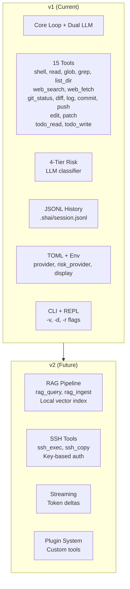

# v1 vs v2 Scope

What's in the current version vs deferred.



---

## v1 Scope (Current Implementation)

### Core Features
| Feature | Status | Details |
|---------|--------|---------|
| **Agent Loop** | ✅ | Manual turn-by-turn, `max_turns(1)` |
| **Dual LLM** | ✅ | Primary + Risk models, separate configs |
| **Risk Classification** | ✅ | 4-tier, LLM-based, temperature=0 |
| **History** | ✅ | JSONL, `.shai/session.jsonl`, 50 turns |
| **Config** | ✅ | TOML + Env, priority merge |
| **Providers** | ✅ | OpenAI, Anthropic, Ollama |
| **CLI** | ✅ | One-shot + REPL |
| **Flags** | ✅ | `-v/--verbose`, `-d/--debug`, `-r/--show-reasoning` |

### v1 Tools (15 Total)

| Category | Tools | Risk | Confirmation |
|----------|-------|------|--------------|
| **Shell** | `shell` | 1–4 (LLM) | Level 2/3: y/N, Level 4: deny |
| **File Read** | `read`, `glob`, `grep`, `list_dir` | 1 (Auto) | None |
| **Web** | `web_search`, `web_fetch` | 1 (Auto) | None |
| **Git Read** | `git_status`, `git_diff`, `git_log` | 1 (Auto) | None |
| **Git Write** | `git_commit`, `git_push` | 3 (WriteRecoverable) | Yes |
| **File Write** | `edit`, `patch` | 3 (WriteRecoverable) | Yes |
| **Task Track** | `todo_read`, `todo_write` | 1 (Auto) | None |

### v1 Dependencies
```toml
rig = { version = "0.46", features = ["agent", "reqwest", "derive"] }
tokio, clap, serde, serde_json, schemars, thiserror, anyhow
tracing, tracing-subscriber, dirs, toml, regex, rustyline
walkdir, ignore, reqwest, scraper, url, git2
```

---

## v2 Scope (Deferred)

### RAG Pipeline
| Feature | Tools | Config | Dependencies |
|---------|-------|--------|--------------|
| **Local Vector Index** | `rag_query`, `rag_ingest` | `[rag]` section | `chromadb`/`qdrant-client`, `onnxruntime` |
| **Per-directory** | `.shai/rag/` | `embedding_model` | Ollama or ONNX for embeddings |

**ADR**: [ADR-010](../ADR.md#adr-010-rag-integration-v2--local-per-directory-index)

### SSH Integration
| Feature | Tools | Config | Dependencies |
|---------|-------|--------|--------------|
| **Remote Execution** | `ssh_exec`, `ssh_copy` | `[ssh]` section | `ssh2`, `tokio-ssh2` |
| **Key-based Auth** | Uses `~/.ssh/config` | `known_hosts` | No password auth |

**ADR**: [ADR-011](../ADR.md#adr-011-ssh-integration-v2--key-based-only)

### Streaming
| Feature | Details |
|---------|---------|
| **Token Deltas** | `stream_completion` for token-by-token output |
| **Use Case** | Long responses, better perceived latency |
| **Challenge** | Tool calls need complete JSON — hybrid approach needed |

### Plugin System
| Feature | Details |
|---------|---------|
| **Custom Tools** | Dynamic tool loading via shared libraries or WASM |
| **Tool API** | Stable `#[rig_tool]` interface for third-party tools |
| **Distribution** | `shai plugin install <name>` from registry |

---

## Migration Path

```
v1.0 → v1.x (bug fixes, more tools)
    ↓
v2.0 (RAG + SSH)
    ↓
v2.x (Streaming + Plugins)
```

### v1 → v2 Breaking Changes
- Config: Add `[rag]`, `[ssh]` sections (optional, backward compatible)
- Tools: New `rag_*`, `ssh_*` tools auto-registered if enabled
- History: Unchanged (`.shai/session.jsonl`)
- CLI/REPL: New flags/commands for v2 features

---

## Decision Matrix

| Feature | v1? | v2? | Rationale |
|---------|-----|-----|-----------|
| Core loop | ✅ | | Foundation |
| Dual LLM | ✅ | | Risk isolation |
| 15 tools | ✅ | | High utility, low risk |
| RAG | | ✅ | Complex, separate pipeline |
| SSH | | ✅ | Network, auth complexity |
| Streaming | | ✅ | Tool call compatibility |
| Plugins | | ✅ | Ecosystem maturity needed |
| GUI/TUI | ❌ | ❌ | Anti-goal |
| Multi-user | ❌ | ❌ | Anti-goal |
| Root execution | ❌ | ❌ | Anti-goal |

---

## ADR References

- [ADR-009](../ADR.md#adr-009-tool-set-v1--readwriteinspectwebgit): v1 tool set
- [ADR-010](../ADR.md#adr-010-rag-integration-v2--local-per-directory-index): RAG v2
- [ADR-011](../ADR.md#adr-011-ssh-integration-v2--key-based-only): SSH v2
- [ADR-005](../ADR.md#adr-005-non-streaming-for-v1): Non-streaming v1