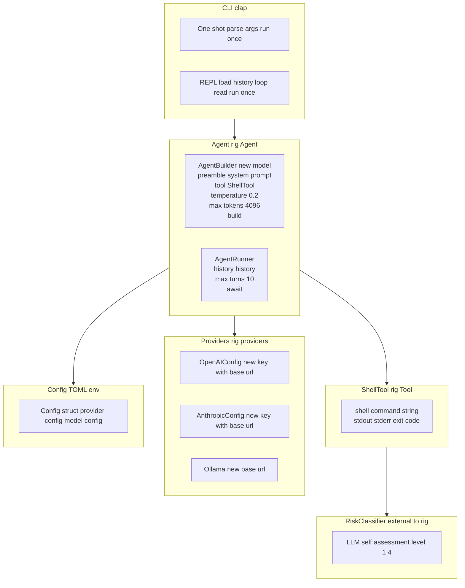
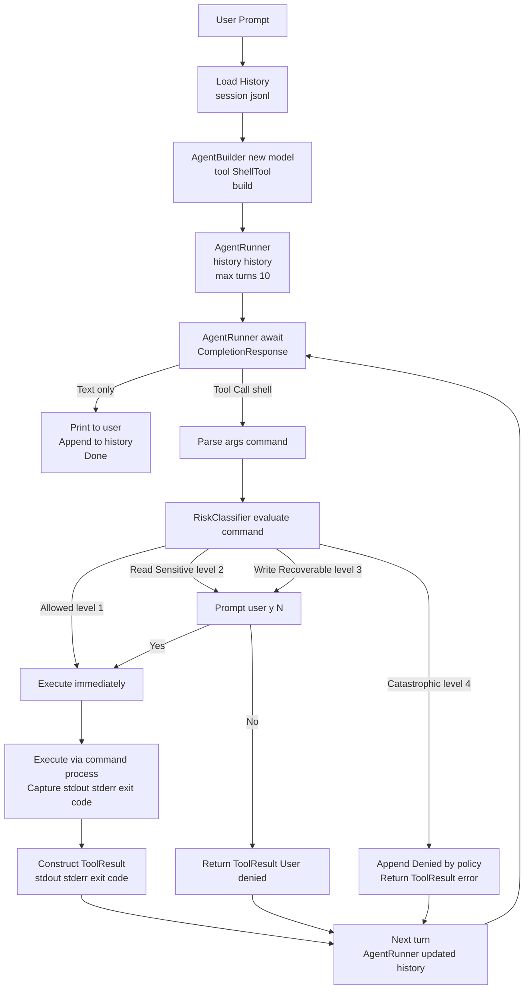

# AI-Powered Shell Agent (shai) — Design Document

**Date:** 2026-11-08  
**Status:** Draft — awaiting approval  
**Size:** Project (written design required)

---

## 1. Intent & Why

A stateful CLI agent (`shai`) that:
- Accepts a natural-language prompt (one-shot or REPL)
- Uses an LLM (via rig) to translate intent into shell commands
- Executes commands via `sh -c` with a **four-tier risk classifier** + user confirmation
- Feeds stdout/stderr/exit code back to the LLM
- Continues the loop until the LLM emits a final answer
- Persists conversation history (JSONL) across invocations in `.shai/session.jsonl`

**Core loop:** `load history → prompt LLM → parse tool call → risk-check → confirm? → execute → append result → repeat`

---

## 2. Goals, Non-Goals, Anti-Goals

| Goals | Non-Goals | Anti-Goals |
|-------|-----------|------------|
| One-shot `shai "list files"` | Full terminal emulation (pty) | Autonomous unattended execution |
| REPL mode with history | GUI / TUI | Running as root by default |
| Four-tier risk eval + confirm | Plugin system (v1) | Storing secrets in history |
| OpenAI / Anthropic / Ollama config | Multi-user sessions | Replacing your shell |
| Config: TOML (~/.config/shai/config.toml) + env vars | | |

---

## 3. Constraints

- **Rust 2021**, `rig` **0.46** (umbrella crate with `agent` feature)
- `rig` provides: `Model`, `CompletionRequest/Response`, `Tool` trait, `Agent`/`AgentBuilder`, provider clients
- **`AgentBuilder` is available** via `rig::agent::AgentBuilder` (feature `agent`)
- Single binary, statically linked where possible
- History stored as JSONL (one `Message` per line) — portable, append-only

---

## 4. Architecture

### 4.1 High-Level Components



### 4.2 Data Flow (One Turn)



---

## 5. rig 0.46 API Mapping (Verified)

The [`rig`](https://crates.io/crates/rig) crate (v0.46) is the umbrella crate that re-exports:
- `rig_core` — core traits, provider clients, completion, tools
- `rig_agent` — `Agent`, `AgentBuilder`, `AgentRunner` (feature `agent`)
- Provider clients: `openai`, `anthropic`, `ollama`, etc.

All examples below use `rig::` imports.

### 5.1 Tool Architecture

All tools use `#[rig_tool]` derive macro. Each tool's `call` is a **stub** — the AgentLoop intercepts tool calls, runs risk check (if applicable), executes, and feeds `ToolResult` back.

**Tool Registry** — AgentLoop dispatches by `tool_call.name`:

| Tool | Category | Risk Level | Config |
|------|----------|------------|--------|
| `shell` | Execute | 2–4 (LLM) | timeout |
| `read` | File read | 1 (Allowed) | — |
| `glob` | File pattern | 1 (Allowed) | — |
| `grep` | Content search | 1 (Allowed) | — |
| `list_dir` | Directory list | 1 (Allowed) | — |
| `web_search` | Web search | 1 (Allowed) | provider/api_key |
| `web_fetch` | Fetch URL | 1 (Allowed) | timeout |
| `git_status` | Git inspect | 1 (Allowed) | — |
| `git_diff` | Git inspect | 1 (Allowed) | — |
| `git_log` | Git inspect | 1 (Allowed) | — |
| `git_commit` | Git write | 3 (WriteRecoverable) | — |
| `git_push` | Git write | 3 (WriteRecoverable) | — |
| `edit` | File modify | 3 (WriteRecoverable) | — |
| `patch` | File modify | 3 (WriteRecoverable) | — |
| `todo_read` | Task track | 1 (Allowed) | — |
| `todo_write` | Task track | 1 (Allowed) | — |
| `rag_query` | RAG (v2) | 1 (Allowed) | index_path |
| `rag_ingest` | RAG (v2) | 2 (ReadSensitive) | index_path |
| `ssh_exec` | SSH (v2) | 3–4 (LLM) | host config |
| `ssh_copy` | SSH (v2) | 3 (WriteRecoverable) | host config |

**v1 Tools:** `shell`, `read`, `glob`, `grep`, `list_dir`, `web_search`, `web_fetch`, `git_status`, `git_diff`, `git_log`, `git_commit`, `git_push`, `edit`, `patch`, `todo_read`, `todo_write`

**v2 Tools:** `rag_query`, `rag_ingest`, `ssh_exec`, `ssh_copy`

### 5.1.1 `ShellTool` (v1)

```rust
use rig::tool::contextual::{Tool, ToolContext};
use rig::tool::IntoToolOutput;
use rig::derive::rig_tool;  // feature "derive"
use serde::{Deserialize, Serialize};
use schemars::JsonSchema;

#[derive(Deserialize, JsonSchema)]
struct ShellArgs {
    command: String,
    #[serde(default)]
    timeout_secs: Option<u64>,
}

#[derive(Serialize, JsonSchema)]
struct ShellOutput {
    stdout: String,
    stderr: String,
    exit_code: i32,
}

impl IntoToolOutput for ShellOutput {}

#[derive(Debug, thiserror::Error)]
enum ShellError {
    #[error("Execution failed: {0}")]
    Exec(#[from] std::io::Error),
    #[error("Timeout")]
    Timeout,
    #[error("Denied by risk policy: {0}")]
    Denied(String),
    #[error("User denied: {0}")]
    UserDenied(String),
}

#[rig_tool(name = "shell", description = "Execute a shell command via `sh -c` and return stdout, stderr, exit code.")]
async fn shell_tool(
    _ctx: &mut ToolContext,
    args: ShellArgs,
) -> Result<ShellOutput, ShellError> {
    // STUB: Actual execution with risk check happens in AgentLoop's tool handler.
    // This tool is registered so the LLM knows its schema.
    // The AgentLoop intercepts tool calls via a custom hook/handler.
    Ok(ShellOutput { stdout: String::new(), stderr: String::new(), exit_code: 0 })
}

// The AgentLoop installs a ToolHandler that:
// 1. Intercepts calls to "shell" tool
// 2. Runs RiskClassifier on the command
// 3. Prompts user if needed
// 4. Executes command via tokio::process::Command
// 5. Returns ToolResult to the agent for next turn
```

**Key point:** The `#[rig_tool]` macro generates the `Tool` impl. The AgentLoop uses a custom `ToolHandler` (via `AgentBuilder::add_hook` or by wrapping `AgentRunner`) to intercept the `shell` tool call, run the risk check, and execute the command — replacing the stub result with the real output.

### 5.2 Provider Clients — Custom `base_url` + `api_key`

```rust
use rig::providers::openai::{OpenAIConfig, OpenAI};
use rig::providers::anthropic::{AnthropicConfig, Anthropic};
use rig::providers::ollama::Ollama;
use rig::driver::DynModel;
use rig::operation::Completion;

// OpenAI / OpenAI-compatible
let openai_config = OpenAIConfig::new(api_key.into())
    .with_base_url(base_url);  // e.g. "https://api.openai.com/v1"
let openai_client = openai_config.client(); // reqwest feature
let model: DynModel<Completion> = openai_client.chat(model_name).into();

// Anthropic
let anthropic_config = AnthropicConfig::new(api_key.into())
    .with_base_url(base_url); // e.g. "https://api.anthropic.com"
let anthropic_client = anthropic_config.client();
let model: DynModel<Completion> = anthropic_client.completion(model_name).into();

// Ollama
let ollama_client = Ollama::new(base_url); // e.g. "http://localhost:11434"
let model: DynModel<Completion> = ollama_client.completion(model_name).into();
```

**Verified:** `OpenAIConfig::new().with_base_url()`, `AnthropicConfig::new().with_base_url()`, `Ollama::new(base_url)` all exist in rig 0.46.

### 5.4 AgentBuilder — Wiring It Together

```rust
use rig::agent::AgentBuilder;
use rig::providers::openai::{OpenAIConfig, OpenAI};
use rig::driver::DynModel;
use rig::operation::Completion;
use rig::completion::Message;

// Build PRIMARY model (for command generation)
let primary_config = OpenAIConfig::new(primary_api_key.into())
    .with_base_url(primary_base_url);
let primary_client = primary_config.client();
let primary_model: DynModel<Completion> = primary_client.chat(primary_model_name).into();

// Build RISK model (for classification) — separate config
let risk_config = OpenAIConfig::new(risk_api_key.into())
    .with_base_url(risk_base_url);
let risk_client = risk_config.client();
let risk_model: DynModel<Completion> = risk_client.chat(risk_model_name).into();

// Build agent with PRIMARY model
let agent = AgentBuilder::new(primary_model)
    .name("shai")
    .description("AI shell agent that executes commands with risk checking")
    .preamble(r#"
You are shai, an AI assistant that executes shell commands to accomplish tasks.
Use the `shell` tool to run commands. The system will evaluate each command for risk
and may ask the user for confirmation before execution.

**Before running commands:**
- Explain what you're doing and why
- If you modify a user's command, explain the change and reason

**After commands execute:**
- Summarize the result (stdout, stderr, exit code)
- Explain what the output means for the task
- Note any errors or unexpected behavior
- Decide next steps based on results

Always be clear and concise in your explanations.
"#)
    .temperature(0.2)
    .max_tokens(4096)
    .tool(shell_tool)  // generated by #[rig_tool]
    .build();

// Risk classifier uses separate RISK model
let risk_classifier = RiskClassifier::new(risk_model);

// Run with history (loaded from .shai/session.jsonl)
let mut history: Vec<Message> = load_history()?;
let mut user_prompt = user_prompt.to_string();

loop {
    // Run exactly ONE turn (stops at first tool call OR final text)
    let runner = agent
        .prompt(user_prompt.clone())
        .history(history.clone())
        .max_turns(1);
    
    let response = runner.await?;
    
    // Check if LLM made a tool call
    if let Some(tool_call) = response.tool_calls().first() {
        if tool_call.name == "shell" {
            let command: String = parse_args(&tool_call.args)?;
            let risk = risk_classifier.evaluate(&command).await?;
            
            let tool_result = match risk.level {
                RiskLevel::Allowed => {
                    let output = execute_command(&command).await?;
                    ToolResult::success(output)
                }
                RiskLevel::ReadSensitive | RiskLevel::WriteRecoverable => {
                    if prompt_user(&command)? {
                        let output = execute_command(&command).await?;
                        ToolResult::success(output)
                    } else {
                        ToolResult::error("User denied execution")
                    }
                }
                RiskLevel::Catastrophic => {
                    ToolResult::error("Denied: catastrophic risk")
                }
            };
            
            // Feed result back for next turn — LLM receives stdout/stderr/exit_code
            // and explains results per system prompt instructions
            history.push(Message::tool_result(tool_call.id, tool_result));
            user_prompt = String::new(); // Empty for continuation turns
            continue;
        }
    }
    
    // No tool call = final response
    println!("{}", response.text());
    history.extend(response.messages());
    save_history(&history)?;
    break;
}
```

**Note:** rig's `AgentRunner` handles the multi-turn loop internally. For risk checking, we either:
1. Use a custom `AgentHook` (advanced) to intercept tool calls
2. Run turn-by-turn manually by calling `agent.prompt(...).max_turns(1).await` in a loop, handling tool calls between turns

Option 2 is simpler and gives full control over the risk/confirm/exec flow.

---

## 6. Configuration

### 6.1 TOML Schema (`~/.config/shai/config.toml`)

```toml
[provider]
type = "openai"        # "openai" | "anthropic" | "ollama"
model = "gpt-4o"       # provider-specific model id
base_url = ""          # optional override
api_key = ""           # optional (env var takes precedence)
temperature = 0.2
max_tokens = 4096

[risk_provider]
type = "openai"        # optional: defaults to [provider] if omitted
model = "gpt-4o-mini"  # smaller/faster model for risk
base_url = ""          # optional override
api_key = ""           # optional (env var takes precedence)
temperature = 0.0      # deterministic for risk classification
max_tokens = 100       # only needs JSON output

[risk]
# LLM-only risk classification (no hardcoded deny/allow patterns)

[rag]
# v2: Local vector index (per-directory .shai/rag/)
enabled = false
index_path = ".shai/rag"
embedding_model = "nomic-embed-text"  # Ollama or local
chunk_size = 512
chunk_overlap = 50

[ssh]
# v2: Key-based only, uses ~/.ssh/config hosts
enabled = false
known_hosts = []  # optional override

[session]
history_path = ".shai/session.jsonl"
max_history_turns = 50

[display]
verbose = false      # Show full tool output (stdout, stderr, exit code)
debug = false        # Show tool calls, risk levels, raw LLM responses, timing
show_reasoning = false  # Show model reasoning (if supported)
```

### 6.2 Environment Variables (override TOML)

| Variable | Maps To |
|----------|---------|
| `SHAI_PROVIDER` | `provider.type` |
| `SHAI_MODEL` | `provider.model` |
| `SHAI_BASE_URL` | `provider.base_url` |
| `SHAI_API_KEY` | `provider.api_key` |
| `SHAI_TEMPERATURE` | `provider.temperature` |
| `SHAI_MAX_TOKENS` | `provider.max_tokens` |
| `SHAI_RISK_PROVIDER` | `risk_provider.type` |
| `SHAI_RISK_MODEL` | `risk_provider.model` |
| `SHAI_RISK_BASE_URL` | `risk_provider.base_url` |
| `SHAI_RISK_API_KEY` | `risk_provider.api_key` |
| `SHAI_RISK_TEMPERATURE` | `risk_provider.temperature` |
| `SHAI_RISK_MAX_TOKENS` | `risk_provider.max_tokens` |
| `SHAI_RAG_ENABLED` | `rag.enabled` |
| `SHAI_RAG_INDEX_PATH` | `rag.index_path` |
| `SHAI_RAG_EMBEDDING_MODEL` | `rag.embedding_model` |
| `SHAI_SSH_ENABLED` | `ssh.enabled` |
| `SHAI_VERBOSE` | `display.verbose` |
| `SHAI_DEBUG` | `display.debug` |
| `SHAI_SHOW_REASONING` | `display.show_reasoning` |
| `OPENAI_API_KEY` | fallback for OpenAI |
| `ANTHROPIC_API_KEY` | fallback for Anthropic |
| `OLLAMA_API_BASE_URL` | fallback for Ollama |

---

## 7. Risk Classifier (Four-Tier)

### 7.1 Levels

| Level | Name | Action | Examples |
|-------|------|--------|----------|
| 1 | **Allowed** | Execute immediately | `ls`, `cat file`, `git status` |
| 2 | **ReadSensitive** | Confirm (y/N) | `cat /etc/passwd`, `aws secretsmanager get-secret-value` |
| 3 | **WriteRecoverable** | Confirm (y/N) | `rm file`, `git reset --hard`, `docker rm` |
| 4 | **Catastrophic** | **Deny** (no prompt) | `rm -rf /`, `dd if=/dev/zero of=/dev/sda`, `mkfs.ext4` |

### 7.2 Evaluation Order

1. **LLM risk assessment** (separate `risk_provider` model, single call) → Level 1–4
   - Prompt includes: command, cwd, recent history
   - Output: JSON `{ "level": 1-4, "reason": "..." }`
   - Few-shot examples baked into prompt for calibration
   - Runs at `temperature=0` for deterministic classification
   - Falls back to `provider` model if `risk_provider` not configured

### 7.3 LLM Risk Prompt (Template)

```
You are a shell command risk classifier. Classify the command into exactly one level:

1 = Allowed (read-only, no sensitive data, no state change)
2 = ReadSensitive (reads secrets, keys, PII, auth tokens)
3 = WriteRecoverable (writes/deletes but recoverable: git reset, rm file, docker stop)
4 = Catastrophic (irrecoverable: rm -rf /, disk format, fork bomb)

Command: {command}
Working dir: {cwd}
Recent history: {last_3_commands}

Output JSON only: {"level": 1, "reason": "..."}
```

---

## 8. History & Session

- **Format:** JSONL, one `rig_core::completion::Message` per line
- **Location:** `.shai/session.jsonl` (relative to cwd) or `config.session.history_path`
- **Load:** On startup, read last `max_history_turns` messages
- **Save:** Append after each turn (user prompt, assistant text, tool call, tool result)
- **REPL:** Same file, shared across invocations
- **One-shot:** Loads existing, appends, saves — so `shai "continue"` works

---

## 9. CLI Interface

```bash
# One-shot
shai "list all .rs files modified this week"
shai --provider anthropic --model claude-3-5-sonnet "summarize git log"

# REPL
shai
shai> list all .rs files modified this week
shai> now show me the diff for the largest one
shai> /exit

# Config
shai config show
shai config set provider.type ollama
shai config set provider.model llama3.1
```

### 9.1 Global Flags (CLI + REPL)

| Flag | Short | Description |
|------|-------|-------------|
| `--verbose` | `-v` | Show full tool output (stdout, stderr, exit code) |
| `--debug` | `-d` | Show tool calls, risk levels, raw LLM responses, timing |
| `--show-reasoning` | `-r` | Show model reasoning (if supported, e.g., o1, deepseek-r1) |

**CLI usage:**
```bash
shai -v "list files"
shai --debug --provider ollama "debug this"
shai -vdr "complex task"
```

**REPL usage (persist for session):**
```bash
shai -v          # Start REPL in verbose mode
shai> /verbose   # Toggle verbose on/off
shai> /debug     # Toggle debug on/off
shai> /reasoning # Toggle reasoning on/off
```

### 9.2 REPL Commands

| Command | Action |
|---------|--------|
| `/exit` / `/quit` | Save history, exit |
| `/history` | Show last N turns |
| `/clear` | Clear history file |
| `/config` | Show current config |
| `/risk <cmd>` | Dry-run risk classification |
| `/verbose` | Toggle verbose mode (show full tool output) |
| `/debug` | Toggle debug mode (show tool calls, risk, raw responses) |
| `/reasoning` | Toggle reasoning display (if model supports it) |

---

## 10. Error Handling & Edge Cases

| Scenario | Handling |
|----------|----------|
| LLM returns empty response | Retry once with stricter prompt; then "I couldn't generate a response" |
| LLM returns malformed tool call | Append parse error to history, ask LLM to retry |
| Command times out | Kill process, return timeout error to LLM |
| Command exits non-zero | Return stderr + exit code to LLM (let it decide next step) |
| User presses Ctrl+C in REPL | Save history, exit cleanly |
| Config file missing/invalid | Print helpful error, show `shai config init` hint |
| Provider auth fails | Print error, suggest env var / config fix |

---

## 11. Project Structure

```
shai/
├── Cargo.toml
├── src/
│   ├── main.rs           # CLI entry, one-shot vs REPL
│   ├── config.rs         # Config struct, TOML + env loading
│   ├── provider.rs       # Provider factory → DynModel<Completion>
│   ├── tool/
│   │   ├── mod.rs        # Tool registry, dispatch, risk integration
│   │   ├── shell.rs      # #[rig_tool] shell_tool
│   │   ├── read.rs       # #[rig_tool] read_tool
│   │   ├── glob.rs       # #[rig_tool] glob_tool
│   │   ├── grep.rs       # #[rig_tool] grep_tool
│   │   ├── list_dir.rs   # #[rig_tool] list_dir_tool
│   │   ├── web_search.rs # #[rig_tool] web_search_tool
│   │   ├── web_fetch.rs  # #[rig_tool] web_fetch_tool
│   │   ├── git.rs        # #[rig_tool] git_status/diff/log/commit/push
│   │   ├── edit.rs       # #[rig_tool] edit_tool, patch_tool
│   │   └── todo.rs       # #[rig_tool] todo_read/write_tool
│   ├── rag/              # v2
│   │   ├── mod.rs        # RAG pipeline (ingest, query)
│   │   ├── index.rs      # Vector index (chroma/qdrant embedded)
│   │   └── embed.rs      # Embedding model (Ollama/local)
│   ├── ssh/              # v2
│   │   ├── mod.rs        # SSH client wrapper
│   │   └── config.rs     # Host config from ~/.ssh/config
│   ├── risk/
│   │   ├── classifier.rs # RiskClassifier (LLM-based)
│   │   └── prompt.rs     # Risk prompt template + few-shots
│   ├── history.rs        # JSONL load/save, Message serialization
│   ├── agent.rs          # AgentBuilder setup, turn-by-turn runner
│   └── repl.rs           # REPL readline + commands
├── tests/
│   └── integration.rs    # Basic smoke tests
└── docs/
    └── superpowers/specs/2026-11-08-ai-shell-agent-design.md
```

---

## 12. Dependencies (Cargo.toml)

```toml
[package]
name = "shai"
version = "0.1.0"
edition = "2021"

[dependencies]
# Core
rig = { version = "0.46", features = ["agent", "reqwest", "derive"] }
tokio = { version = "1", features = ["full"] }
clap = { version = "4", features = ["derive", "env"] }
serde = { version = "1", features = ["derive"] }
serde_json = "1"
schemars = "1"
thiserror = "1"
anyhow = "1"
tracing = "0.1"
tracing-subscriber = { version = "0.3", features = ["env-filter"] }
dirs = "5"
toml = "0.8"
regex = "1"
rustyline = "12"  # REPL readline

# File tools
walkdir = "2"
ignore = "0.12"  # .gitignore support for glob/grep

# Web tools
reqwest = { version = "0.12", features = ["json", "gzip", "brotli", "native-tls"] }
scraper = "0.20"  # HTML parsing for web_fetch
url = "2"

# Git tools
git2 = "0.18"

# SSH tools (v2)
ssh2 = "0.10"
tokio-ssh2 = "0.2"  # if available, else sync in thread pool

# RAG tools (v2)
chromadb = "0.3"  # or qdrant-client = "1"
onnxruntime = "0.10"  # for local embeddings, or use Ollama via reqwest
```

**Note:** `rig` features:
- `agent` — enables `Agent`, `AgentBuilder`, `AgentRunner`
- `reqwest` — enables provider HTTP clients (`client()` method)
- `derive` — enables `#[rig_tool]` macro for tool generation

---

## 13. Open Questions (For Approval)

1. **LLM-only risk evaluation?** **Decided: Yes** — LLM-only with strong few-shots (no hardcoded deny/allow lists). 

2. **Single LLM call for risk (self-assessment) or dual-LLM?** **Decided: Dual LLM** — risk assessment uses a separate model/config from the primary agent. Allows smaller/faster model for risk, different temperature, or different provider.

3. **History scope:** **Decided: Per-directory** (`.shai/session.jsonl`) — project-scoped sessions.

4. **Streaming output?** **Decided: Non-streaming for v1** — may add later.

5. **Shell vs direct exec?** **Decided: `sh -c`** — supports pipes, redirects, builtins.

6. **Agent loop: hook vs manual turn-by-turn?** **Decided: Option B (manual turn-by-turn)** — explicit loop with `max_turns(1)` gives full control over risk/confirm/exec flow, easier debugging, no hook API dependency.

---

## 14. Approval Gate

> **Nothing gets built until this design is approved.**  
> Reply with "approved" or request changes. Once approved, I'll invoke `writing-plans` for the implementation plan.